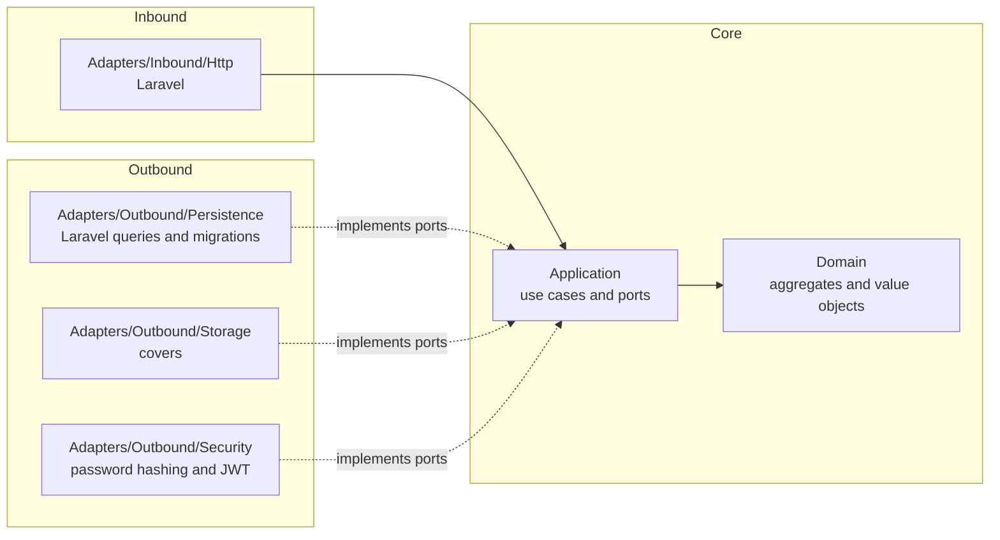
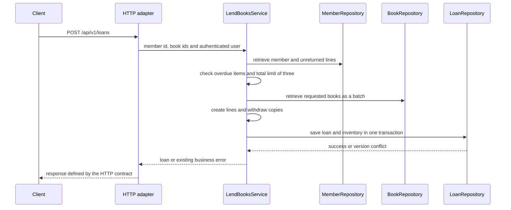

# Architecture — Manager Library (React + Laravel)

**Hexagonal architecture** (ports and adapters), translated from the [.NET reference](../spec-.net/architecture.md) to the stack required by the [base README](../README.md). The dependency rules remain articles I–III of [constitution.md](constitution.md). The original design and audit are preserved below; [plan.md](plan.md)'s implementation records identify adopted resolutions and [tasks.md](tasks.md) links executed evidence.

Documentation is in English as requested for this adaptation. The original requirement for Spanish user-facing messages remains unchanged. Business rules, the six-table model and HTTP operations remain those of [spec.md](spec.md), [data-model.md](data-model.md) and [api-contract.md](api-contract.md).

## 1. Layers and dependencies



Dependencies point inward. The adopted Laravel composition location is `app/Providers/LibraryServiceProvider.php`: it binds application ports to adapters. Framework routing and bootstrapping remain framework integration, not an alternative location for business rules.

The domain uses standard PHP types, including `DateTimeImmutable`. It does not import Illuminate, Eloquent, Carbon, application services or adapters. The application owns its ports; their signatures do not expose Laravel requests, ORM models or database connections. The implementation selects parameterized Laravel query-builder adapters and explicit row-to-domain mapping rather than generating Eloquent business entities. This is within the plan's Eloquent/SQL persistence choice.

## 2. Folder structure

The equivalent layout in the `api` repository is:

```text
app/
├── Library/
│   ├── Domain/                    # Book, Loan, LoanItem, Member, User; value objects
│   ├── Application/
│   │   ├── Ports/                 # BookRepository, LoanRepository, MemberRepository,
│   │   │                          # UserRepository, ReportReader, Clock,
│   │   │                          # PasswordHasher, TokenIssuer, CoverStorage
│   │   └── Services/              # lending, returns, catalogue, authentication,
│   │                              # members, loan queries, overdue items and reporting
│   └── Adapters/
│       ├── Inbound/Http/          # controllers, request validation and error translation
│       └── Outbound/              # persistence, storage and security
└── Providers/LibraryServiceProvider.php
```

Laravel migrations belong to `api`. The React application stays in the separate `app` repository, with HTTP access, authentication and feature components kept distinct. It consumes the existing API; the public `page` site remains separate and static. No combined Laravel/React application replaces the six repositories required by the README.

The layout translates the reference structure; it does not add domain entities, database columns, endpoints or delivery milestones. Framework-generated files must be reviewed against the specified model rather than accepted automatically.

## 3. Aggregates

| Root | Contains | Invariants it protects |
|---|---|---|
| `Book` | ISBN, total and available copies, logical deletion | Availability between zero and total; total at least one; nonempty title |
| `Loan` | `LoanItem` collection | One to three lines; no repeated book; fourteen-day due date; immutable except for returns |
| `Member` | Document number | Required document; uniqueness also requires persistence enforcement |
| `User` | Normalized username, role and password hash | Username normalization; role in `admin`, `librarian` |

Adding a loan line and withdrawing one copy form one operation. Returning a line and restocking one copy also form one operation; neither can be persisted independently of the other.

`Quantity` in the reference represents a positive quantity. Available copies can be zero, so applying that value object indiscriminately would reject a valid inventory state. The domain receives the current instant from the use case as a standard PHP value; it does not depend on the application's `Clock` interface.

The range check protects `0 <= available_copies <= total_copies`. It does not, on its own, prove that inventory agrees with outstanding loan lines. The relationship implied by creation, lending, returns and total adjustments is: available copies equal total copies minus the number of unreturned lines for that book. This is an audit property of the existing rules, not a new column or table.

## 4. Flow: register a loan



This is the reference's logical flow, not a complete concurrency algorithm. A failure on any line must leave no partial loan or inventory reduction. [ADR-002](adr/adr-002-concurrencia-optimista.md) requires optimistic version checking for books, but the physical model does not identify the version token. That is a confirmed definition gap, not evidence of a defective implementation.

Several implementation decisions must therefore be resolved without silently changing the model or contract:

- **Member limit:** version checks on different books do not coordinate two requests by the same member. Both could observe two outstanding lines and each add another. Coordination on the member while rereading eligibility is a proposed solution; a member row lock is one possible mechanism, not an adopted schema change.
- **Book version:** PostgreSQL's existing `xmin` system column is a possible adapter-only token that avoids adding a physical column. Its lifetime, comparison and retry behavior need an explicit implementation decision; it must not be treated as a permanent identifier. [PostgreSQL system columns](https://www.postgresql.org/docs/16/ddl-system-columns.html).
- **Returns:** simultaneous requests can both initially observe an unreturned line. Returning the line and incrementing inventory must be atomic, with state reread after a conflict. The existing `ITEM_ALREADY_RETURNED` response applies when a prior return is established; the reference does not define every other return-conflict response.
- **Other book writes:** total changes, logical deletion and cover changes can overlap with lending/returns. The version-check scope and complete-operation retry strategy need to cover the applicable state transitions, not merely one inventory update. A logical deletion must consider every unreturned line, including overdue lines.

These points clarify what must be decided and demonstrated. They do not add an isolation level, locking protocol, retry policy or error code to the original contract. The [plan](plan.md) and the audit notes accompanying [tasks.md](tasks.md) record the remaining interpretation work.

## 5. Errors

The domain and application raise their own errors, such as `BookNotAvailable`, `MemberHasOverdue` and `MemberLimitExceeded`. Only the HTTP adapter maps them to the existing error body and status codes in [api-contract.md](api-contract.md). Framework validation, authentication and infrastructure failures must not leak stack traces or SQL to the client. Missing general-error mappings are a contract clarification to resolve, not permission to invent new business errors.

The reference's claim that a failed inventory `CHECK` proves a write outside the adapter is incorrect: a defect inside the adapter can also cause an invalid write. A constraint failure identifies an integrity violation; it does not identify its author.

React displays the contract's Spanish messages and uses Bearer authentication. Reading a protected cover requires an authenticated request; a plain image URL cannot by itself add the Bearer header. The frontend can fetch the binary and display an object URL without exposing the token in a query string or making the existing route public.

## 6. What is not included

No events, queues, cache, microservices or multi-tenancy are added. No new business entities, fields, endpoints or schema changes are introduced by this adaptation. The implementation must preserve the original scope and provide the evidence required by the README and task list.
