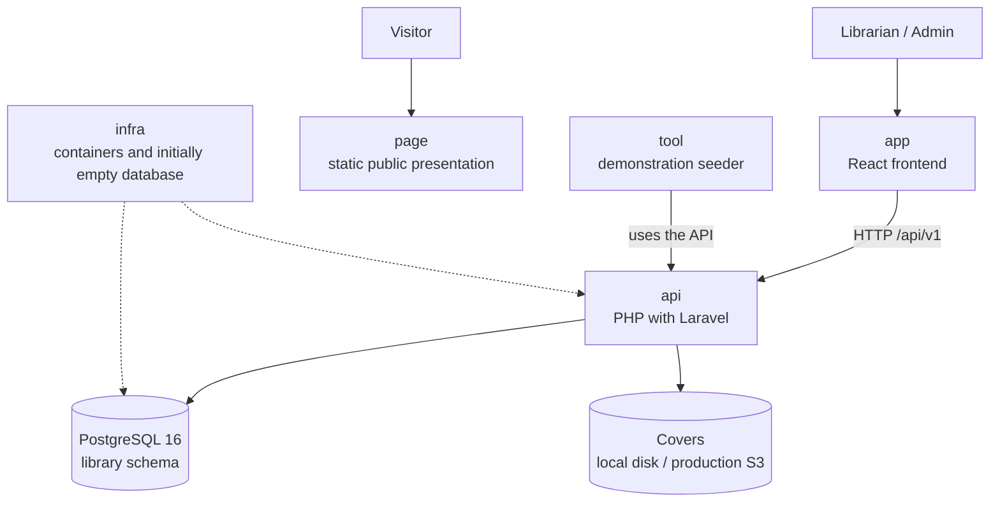

# Architecture at a glance — Manager Library (React + Laravel)

A short introduction before reading the detailed [architecture](architecture.md). The [base README](../README.md) requires React and PHP with Laravel while preserving the product, acceptance criteria, HTTP contract and data model. This English adaptation describes that translation; user-facing messages remain Spanish as required by the reference.

## The system in one picture

## The six repositories and their roles

| Repository | Role | Evidence |
|---|---|---|
| `docs` | Specification, interpretation and architectural decisions | Documentation sufficient to guide implementation, with unresolved gaps identified |
| `api` | Business rules, HTTP contract and application-owned migrations | Domain, application, contract, integration and concurrency tests |
| `app` | React operational screens | End-to-end login → lending → returns → reporting walkthrough |
| `page` | Static public presentation, without API calls | Review on mobile and desktop with the API unavailable |
| `infra` | Containers, network, volumes and an initially empty database | The single startup command documented for the project |
| `tool` | Demonstration books, members and loans created through the API | The original demonstration data and overdue-item requirements |

These remain separate forks with the responsibilities specified by the README. The implementation records in plan.md and executed-evidence register in tasks.md now identify the actual local runtime; this design diagram alone does not prove a deployment. Production S3 remains unconfigured and unvalidated.

## The five ideas behind the design

1. **A loan is an immutable fact.** Only a line's `returned_at` changes when it is returned. The member's limit counts unreturned books across all loans, not loan headers.
2. **Inventory and loan lines change together.** Creating a line withdraws one copy; returning it restores one copy exactly once. A range check alone cannot prove that the count matches the outstanding lines. Concurrent member eligibility and returns need the clarifications in [architecture.md](architecture.md).
3. **State is calculated.** `open`, `overdue` and `closed` are not stored columns. Fourteen-day due dates and the overdue demonstration coexist through the adopted, isolated business clock described in plan.md and verified by T-21. It introduces no HTTP feature or date field.
4. **Frozen values do not follow the catalogue.** Reports use the title and category recorded on the loan line. Renaming a catalogue entry does not rewrite historical results.
5. **The database is a final integrity barrier.** Constraints complement domain rules and coordinated transactions. A failed `CHECK` may result from an adapter defect as well as an external write; it does not establish who caused the violation. Laravel conventions must be configured to preserve the existing six-table model.

The original task identifiers, scope and evaluation focus remain in [tasks.md](tasks.md). The README evaluates how the specification is interpreted and applied through SDD; the technology translation and the audit notes do not create additional evaluation milestones.
