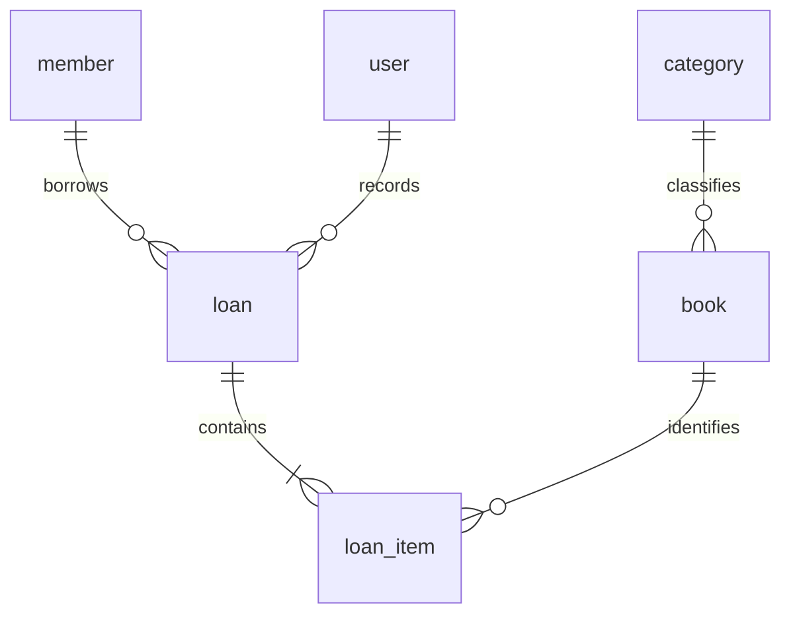

# Data model — Manager Library (React and Laravel)

This document translates the [baseline data model](../spec-.net/data-model.md) for the React/PHP Laravel stack required by the [repository README](../README.md). The baseline business schema is preserved: **six tables, thirty columns, the same types, nullability, foreign keys, constraints, indexes and fixed category data**. No implementation or executed database is asserted.

- Reference database: PostgreSQL 16. Business schema: `library`. Server time zone: UTC.
- Business requirements remain in [spec.md](spec.md); principles in [constitution.md](constitution.md); HTTP representations in [api-contract.md](api-contract.md).
- Baseline labels are retained: **engine**, **domain only**, and **pending (T-xx)**. Here, **engine** identifies the required database guarantee, not evidence that it has already been implemented. All implementation evidence remains pending until produced.
- The final audit register distinguishes preserved requirements from proposed resolutions. Proposals do not silently add columns, constraints, indexes, tables or API behavior.

## 0. Naming conventions

| Element | Convention | Example |
|---|---|---|
| Table | English, singular, `snake_case` | `loan_item` |
| Column | English, singular, ASCII, `snake_case` | `due_at` |
| Manually named constraint | `ck_{table}_{rule}` | `ck_book_available_range` |
| Schema | `library` | `library.loan` |

Write `library."user"` in handwritten SQL; the persistence adapter must quote identifiers correctly.

Laravel conventions must be configured to match this model: singular table names, application-generated UUID keys, no incrementing business keys and no automatic `created_at`/`updated_at`. Eloquent types belong to adapters, not domain entities. The HTTP contract requires UUID v4; a framework default using another UUID version must not override it.

Laravel may require technical migration bookkeeping. The baseline does not define its physical representation. This document therefore defines **no additional technical table or schema**. Any proposed bookkeeping outside the six-table model requires an explicit compatibility decision before schema changes; it is not an exception granted by this document. See [ADR-001](adr/adr-001-propiedad-del-esquema.md).

## 1. Glossary

| Term | Meaning | Storage |
|---|---|---|
| Book | Catalog title, author, ISBN, category, copies and optional cover | `book` |
| Category | One of five fixed seeded classifications, without maintenance operations | `category` |
| Copy | Physical copy counted without an individual identifier | `book.total_copies`, `book.available_copies` |
| Member | Borrower who does not sign in | `member` |
| Loan | Recorded borrower, operator and time | `loan` |
| Loan item | One book in a loan, with due and return times | `loan_item` |
| Loan status | Calculated `open`, `overdue` or `closed` | No column |
| User | Internal operator with role `admin` or `librarian` | `user` |
| Snapshot | Value captured when lending, independent of later catalog changes | `loan_item.book_title`, `isbn`, `category_name` |

## 2. Entities and relationships



Six entities, six tables. No report, fine, audit or individually identified copy table is introduced.

## 3. Physical model

**No column has a `DEFAULT`.** The application supplies values. The following tables preserve every baseline column, type and nullable flag.

**`category`** — read-only seed data.

| Column | Type | Nullable | Note |
|---|---|---|---|
| `id` | `uuid` | No | PK; fixed literals in §9 |
| `name` | `varchar(120)` | No | Unique |

**`book`**

| Column | Type | Nullable | Note |
|---|---|---|---|
| `id` | `uuid` | No | PK |
| `title` | `varchar(250)` | No | Trimmed by the domain |
| `author` | `varchar(200)` | No | Author |
| `isbn` | `char(13)` | No | Digits only; unique among active books through a partial index |
| `category_id` | `uuid` | No | Restrictive FK to `category` |
| `total_copies` | `integer` | No | At least 1 |
| `available_copies` | `integer` | No | Between 0 and `total_copies` |
| `cover_key` | `varchar(512)` | Yes | Opaque key; never a path or bytes; never an empty string |
| `deleted_at` | `timestamptz` | Yes | Logical deletion; null means active |

**`member`**

| Column | Type | Nullable | Note |
|---|---|---|---|
| `id` | `uuid` | No | PK |
| `full_name` | `varchar(200)` | No | Member name |
| `document_number` | `varchar(30)` | No | Unique |

**`loan`**

| Column | Type | Nullable | Note |
|---|---|---|---|
| `id` | `uuid` | No | PK |
| `member_id` | `uuid` | No | Restrictive FK to `member` |
| `loaned_by_user_id` | `uuid` | No | Restrictive FK to `user` |
| `loaned_at` | `timestamptz` | No | Loan time |

**`loan_item`**

| Column | Type | Nullable | Note |
|---|---|---|---|
| `id` | `uuid` | No | PK |
| `loan_id` | `uuid` | No | FK with `ON DELETE CASCADE` |
| `book_id` | `uuid` | No | Restrictive FK to `book` |
| `book_title` | `varchar(250)` | No | Snapshot; same width as `book.title` |
| `isbn` | `char(13)` | No | Snapshot |
| `category_name` | `varchar(120)` | No | Snapshot; deliberately no FK |
| `due_at` | `timestamptz` | No | `loaned_at` plus 14 days, calculated by the domain |
| `returned_at` | `timestamptz` | Yes | Null until returned |

**`user`**

| Column | Type | Nullable | Note |
|---|---|---|---|
| `id` | `uuid` | No | PK |
| `username` | `varchar(120)` | No | Unique, lowercase and trimmed |
| `password_hash` | `varchar(512)` | No | Never indexed |
| `role` | `varchar(40)` | No | `admin` or `librarian` |

All timestamps use `timestamptz`. No generic audit columns (`created_at`, `updated_at`) are present because the requirements do not request them. There is no added version column; the missing representation of the required version token is recorded as an audit gap below.

## 4. Constraints and indexes: where each rule lives

The following inventory retains the baseline objects. The two checks explicitly assigned to T-18
are now applied and verified by direct psql rejection tests; no other check, index or named
constraint has been added. All six tables and thirty columns remain unchanged.

| Rule | Object | Baseline / observed implementation classification |
|---|---|---|
| Primary keys on all six tables | `PK_*` | **engine** |
| Unique `category.name` | Unique index | **engine** |
| Unique `member.document_number` | Unique index | **engine** |
| Unique `user.username` | Unique index | **engine** |
| Unique ISBN among active books | Partial unique index `WHERE deleted_at IS NULL` | **engine** |
| `book.category_id` → `category.id` RESTRICT | FK | **engine** |
| `loan.member_id` → `member.id` RESTRICT | FK | **engine** |
| `loan.loaned_by_user_id` → `user.id` RESTRICT | FK | **engine** |
| `loan_item.loan_id` → `loan.id` CASCADE | FK | **engine** |
| `loan_item.book_id` → `book.id` RESTRICT | FK | **engine** |
| `0 <= available_copies <= total_copies` | `ck_book_available_range` | **engine**; protects the numerical range |
| `total_copies >= 1` | `ck_book_total_positive` | **engine, verified T-18**; originally pending; domain validation retained |
| Unique `(loan_id, book_id)` | Unique index | **engine** |
| `role` in (`admin`, `librarian`) | `ck_user_role` | **engine, verified T-18**; originally pending; domain validation retained |
| At most three unreturned books per member | — | **domain only**; not a row-level `CHECK` |
| A member with overdue items cannot borrow | — | **domain only** |
| Decrementing a copy and creating its loan item form one operation | — | **domain only**; one transaction |
| A loan has one to three items | — | **domain only** |
| Loans and returns are immutable except for completing `returned_at` | — | **domain only**; no editing/deletion operation |

Baseline access indexes: `book (category_id, title)` partial on active books; `loan (loaned_at)`; `loan_item (book_id)`; and `loan_item (due_at) WHERE returned_at IS NULL` for overdue items. No index on `loan (member_id)` is added.

The range constraint does not by itself prove the inventory relationship implied by lending and returning: available copies must equal total copies minus unreturned items for that book. This is a verification property of the existing rules, **not a new stored counter, constraint or trigger**. Transactional enforcement is discussed as a proposed resolution in [ADR-002](adr/adr-002-concurrencia-optimista.md).

## 5. Foreign key policy

| # | FK | `ON DELETE` | Reason |
|---|---|---|---|
| FK-1 | `book.category_id` | RESTRICT | A category referenced by books cannot be deleted |
| FK-2 | `loan_item.loan_id` | CASCADE | Composition: an item does not exist independently of its loan |
| FK-3 | `loan_item.book_id` | RESTRICT | A direct book deletion cannot orphan its history |
| FK-4 | `loan.member_id` | RESTRICT | A loan retains its member |
| FK-5 | `loan.loaned_by_user_id` | RESTRICT | A loan retains its recording operator |

All use `ON UPDATE NO ACTION`: application UUIDs do not change. The application does not delete loans, but the preserved `CASCADE` is not a database guarantee against arbitrary SQL deletion of a loan and its items. This distinction does not change the FK policy.

## 6. Access patterns

| # | Pattern | Frequency |
|---|---|---|
| Q1 | Search active books by text/category, ordered by title and paginated | High |
| Q2 | Read a book by id | High |
| Q3 | Read a batch of book ids before lending | High; contention point |
| Q4 | List categories | High |
| Q5 | Read a loan with its items | Medium |
| Q6 | List loans by date range, status and member | High |
| Q7 | Count a member's unreturned items and find overdue items | High; every loan |
| Q8 | List all overdue items | Medium |
| Q9 | Most-borrowed report by date range | High; most expensive read |
| Q10 | Find a user by username | High; every sign-in |

The maximum of three refers to unreturned **items across all loans**, not three loan headers. Derived loan status and overdue days are not stored. The baseline does not fully define transaction isolation or cross-book coordination for a member; those gaps remain explicit in ADR-002.

## 7. Privacy and retention

| Table | Attributes | Classification | Handling |
|---|---|---|---|
| `user` | `username` | Personal data | Restricted access |
| `user` | `password_hash` | Secret | Never in logs or responses; never indexed |
| `member` | `full_name`, `document_number` | Personal data | Only `admin` and `librarian`; never in reports or public endpoints |
| `loan`, `loan_item` | All; `member_id` indirectly identifies a person | Business data | Indefinite retention |
| `book`, `category` | All | Public catalog data | Logical deletion / no deletion |

The report aggregates books and does not expose members or operators. The public classification of catalog data does not override the HTTP contract's authentication requirements.

Loans and items are never deleted by the application; books are logically deleted. The cover binary is the only business data physically deleted. The baseline order is preserved: first clear `cover_key` and commit the transaction, then delete the binary. Replacement and cleanup failures require a scoped operational decision; no extra persistence is defined here.

## 8. Audit

The system has no generic `created_at`/`updated_at`. Business times already have their columns, including `loan.loaned_at`, `loan_item.returned_at` and `book.deleted_at`. A new question such as who changed a title requires a scope decision; it does not authorize an audit table or extra columns.

Database inspection establishes observed state. Requirements and versioned migrations establish expected state. A difference must be investigated before deciding whether the document or implementation is wrong; an accidental database change does not automatically become a requirement. The final register records this clarification of the baseline's conflicting precedence statements.

## 9. Seed strategy

The initial application migration contains the same five categories, with these literal identifiers and Spanish names. They are fixed business data and are **not translated**:

| `id` | `name` |
|---|---|
| `11111111-1111-4111-8111-111111111111` | Novela |
| `22222222-2222-4222-8222-222222222222` | Ciencia |
| `33333333-3333-4333-8333-333333333333` | Tecnología |
| `44444444-4444-4444-8444-444444444444` | Historia |
| `55555555-5555-4555-8555-555555555555` | Infantil |

The database does not seed the administrator: application startup creates it from environment credentials through the password-hashing port. The demonstration tool uses the **API only**, never direct SQL. No backdated records, new seed categories or additional records are created by this documentation.

## 10. Verification against the database

The following baseline read-only queries are retained as future verification aids. They are not migration or seed scripts and have not been executed as evidence in this documentation task.

```sql
SELECT table_name, ordinal_position, column_name, data_type, is_nullable, column_default
FROM information_schema.columns WHERE table_schema = 'library' ORDER BY 1, 2;

SELECT c.conrelid::regclass, c.conname, c.contype, pg_get_constraintdef(c.oid)
FROM pg_constraint c JOIN pg_namespace n ON n.oid = c.connamespace
WHERE n.nspname = 'library' ORDER BY 1, 3, 2;

SELECT tablename, indexname, indexdef FROM pg_indexes WHERE schemaname = 'library' ORDER BY 1, 2;
```

Compare results with §3–§5. The original queries do not inspect text widths or category contents; read-only inspection should additionally compare those against §3 and §9. After lending/returning tests, compare each book's availability with its unreturned item count and each member's pending total. These are proposed evidence checks, not new schema objects or demonstrated results.

An **engine** requirement absent from an implementation is a discrepancy to investigate, not proof that someone deleted it. A **pending** requirement is not relabeled as implemented before its migration and evidence exist.

## Audit findings and proposed resolutions

| Priority / type | Baseline evidence | Problem | Scoped resolution and compatibility review |
|---|---|---|---|
| P1 · Definition gap | [Model §3](../spec-.net/data-model.md#3-modelo-físico), [ADR-002](../spec-.net/adr/adr-002-concurrencia-optimista.md) | A book version token is required but has no representation in the physical model | Evaluate PostgreSQL's existing `xmin` as an adapter-only ephemeral token; add no business column or HTTP field. Review its operational limits and integration evidence before adopting the proposal |
| P1 · Implementation trap | [Model §4](../spec-.net/data-model.md#4-restricciones-e-índices-dónde-vive-cada-regla), [HU-06/HU-07](../spec-.net/spec.md#hu-06--registrar-un-préstamo) | A valid numerical range does not prove that every loan/return changes inventory exactly once | Verify the inventory relationship and atomic operations under concurrency; no added constraint, index or stored counter. ADR-002 proposes coordination mechanisms |
| P2 · Definition gap | [Model §3–§4](../spec-.net/data-model.md#3-modelo-físico), [constitution VI](../spec-.net/constitution.md#artículo-vi--las-invariantes-que-la-base-puede-imponer-la-base-las-impone) | Digit-only ISBN, nonempty cover keys and normalized usernames are described but not fully classified as engine/domain guarantees | Keep existing validation requirements and the exact baseline schema. Request a classification/compatibility decision before adding any `CHECK`; none is added here. Keep total-positive and valid-role constraints pending T-18 |
| P2 · Definition gap | [Model introduction and §10](../spec-.net/data-model.md), [constitution X](../spec-.net/constitution.md#artículo-x--gana-el-motor) | The model both defers to requirements and claims precedence; observed database state is treated as automatically normative | Distinguish observed from expected state and reconcile discrepancies against the README, requirements and migrations, without rewriting business rules |
| P2 · Implementation trap | [Model §5](../spec-.net/data-model.md#5-política-de-claves-foráneas) | `CASCADE` does not enforce immutable loan history against arbitrary SQL | Preserve the FK and the absence of application deletion operations; document the limit instead of claiming stronger database protection |
| P2 · Implementation trap | [README stack](../README.md#el-reto-se-desarrolla-con-react-y-php-laravel), [model §0/§3](../spec-.net/data-model.md#0-convención-de-nombres) | Framework naming, timestamps, UUID defaults or bookkeeping may diverge from the exact model | Configure Laravel's adapters explicitly. Any additional technical schema object requires compatibility review; this document authorizes none |

These findings are not observations of defects in executable code. Proposed schema or externally visible contract changes require a separate decision; none is part of this adaptation.
